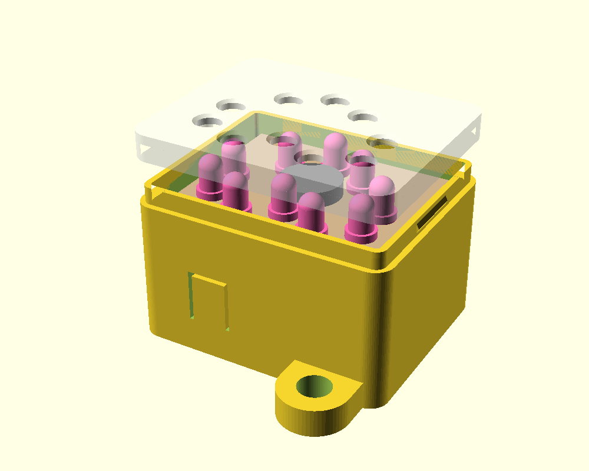
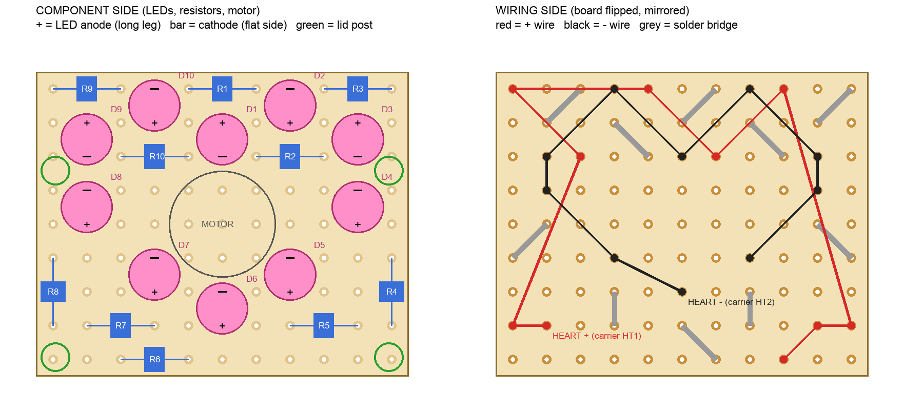

# 3D-printed case

Two parts per keychain, both printed **without supports**:

- **Tray:** floor, battery bay, carrier + SIM800L, USB-C opening, a flexing **button tab**
  printed into the wall, the keyring loop, and an **antenna channel** on the left for the
  SIM800L spring antenna.
- **Lid:** snaps onto the tray (tongue-and-groove with snap ridges). It has **10 holes in
  a heart** that the 3 mm LED domes stick through (1.5 mm proud), plus 4 posts that press
  the heart perfboard down.

Outer size **33.5 × 27.3 × 21.8 mm** plus 1.5 mm LED domes and the keyring loop. Where the
height goes: battery 5.0 (502025 LiPo, 5 × 20 × 25 mm), carrier parts + PCB 4.2, SIM800L with its SIM holder 4.7, heart
perfboard with wiring and LEDs 5.5, floor and lid 2.4.

## Heart perfboard

`heart_perfboard.py` lays out 10 × 3 mm LEDs and their resistors on an 11 × 9-hole
universal board, with the motor in the middle. It writes:
- `out/heart_perfboard.png`: the build drawing, component side and wiring side.
- `out/heart_perfboard.txt`: the hole-by-hole list.
- `heart_layout.scad`: the LED and post positions, so the lid holes match the board.

Solder the LEDs **flat on the board**. The lid is designed for LEDs 5.3 mm tall from flange
to dome top. Measure yours and set `led_h` if they differ. If they're shorter, the domes
stick out less.

## Files

| File | |
|---|---|
| `keychain_case.scad` | Parametric OpenSCAD model; every dimension is at the top |
| `heart_perfboard.py`, `heart_layout.scad` | Heart perfboard layout (generates the lid hole positions) |
| `out/heart_perfboard.png`, `.txt` | Perfboard build drawing and hole list |
| `out/case_tray.stl`, `out/case_lid.stl` | One keychain (lid already flipped for printing) |
| `out/case_plate.stl` | Both keychains: 2 trays + 2 lids laid out on one plate |
| `out/keychain_case_x2_ender3v2_PLA_0.12mm.gcode` | **Ready to print** on an Ender-3 V2 / Ender-3 Pro: PLA, 0.12 mm layers, about 2 h 31 min, 14 g |
| `ender3v2_pla_0.12.ini` | The slicer settings used (Creality's official PrusaSlicer presets, flattened) |
| `scripts/build.sh` | Regenerates STLs, previews and G-code |

## Print

1. Copy the `.gcode` to the printer's microSD card and print it. It's sliced with
   PrusaSlicer's built-in **Creality Ender-3 V2 (0.4 mm nozzle)** printer, **0.12 mm
   DETAIL** print and **Generic PLA** filament presets. The Ender-3 Pro has the same
   220 × 220 bed, nozzle, Bowden extruder and Marlin firmware, so the file works on both.
2. Any PLA colour works, because the LEDs stick through the lid. For coloured trays and a
   different lid colour, open `case_tray.stl` and `case_lid.stl` separately in PrusaSlicer
   and print them as two jobs.
3. Clean, well-levelled bed: the lids print top-face down, so the first layers are the
   outside of the lid.

### Using PrusaSlicer yourself

The installed PrusaSlicer has the Creality profiles. On first start, its Configuration
Wizard asks for printers: pick **Creality → Ender-3 V2** (or **Ender-3 Pro**), 0.4 mm
nozzle. Then open the STL, choose *0.12 mm DETAIL @CREALITY* and *Generic PLA @CREALITY*,
and slice. Alternatively, *File → Import → Import Config* loads `ender3v2_pla_0.12.ini`.

## Fit tuning (if needed after a test print)

All in `keychain_case.scad`, then run `scripts/build.sh`:

| Symptom | Parameter |
|---|---|
| Lid too tight / too loose | `fit` (0.15 mm; +0.05 looser) |
| Boards don't drop in | `clr` (0.3 mm) |
| Button needs too much / too little pressure | `clr_top` / `btn_protrusion` (nub length) |
| USB-C plug doesn't seat fully | `wall`, or the outside recess in `usb_cutout()` |
| No spring antenna (u.FL + flat antenna instead) | `antenna = false` (case gets 4.5 mm narrower) |
| LEDs stick out too much / too little | `led_h` (your LED's height), `led_protrude` |
| LEDs too tight in the holes | `led_hole` (3.2 mm) |

## Assembly

1. Battery into the bottom of the tray (a strip of double-sided foam tape), leads up the
   side.
2. A piece of Kapton or electrical tape on top of the battery. The carrier's bottom-side
   parts rest on it.
3. Carrier + SIM800L (already soldered together), USB-C into its opening. The side switch
   sits against the button tab. Lay the spring antenna in the left channel.
4. Stick the coin motor on the middle of the heart perfboard (component side). Put a layer
   of tape on the SIM800L's shield, lay the perfboard on it, LEDs up, and route the
   heart's +/- wires and the motor wires down the antenna channel to the carrier pads.
   Then line up the LEDs with the lid holes.
5. Snap the lid on. To open, lever it at the USB-C end with a fingernail.
