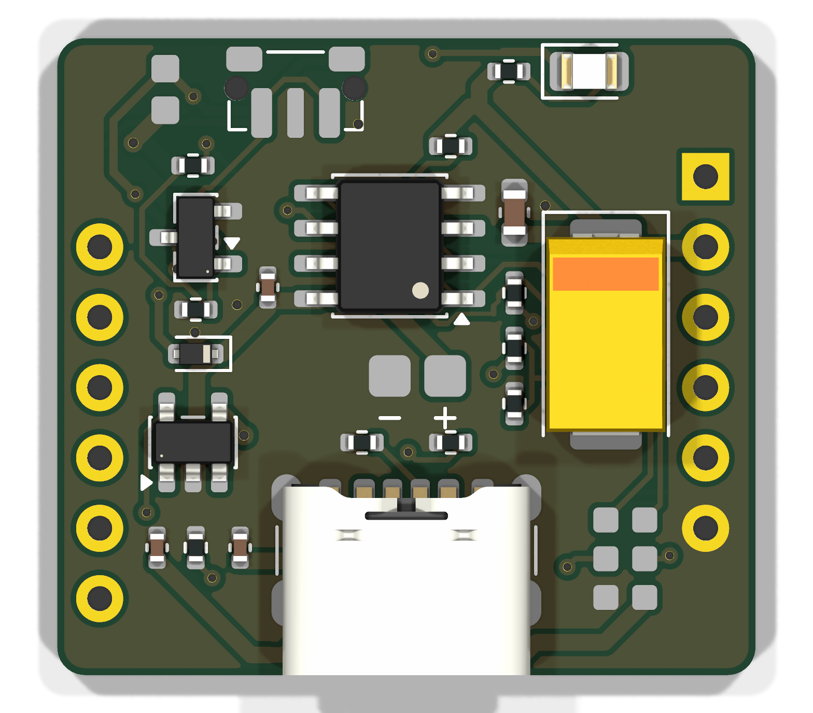
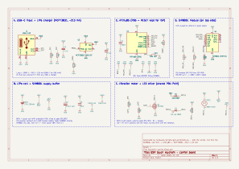

# Carrier PCB — GSM touch keychain

A 2-layer, **0.8 mm** board with the **same 25.2 × 23.0 mm outline as the red SIM800L
mini module**. The module sits on top and is soldered straight through its own 12 holes.
All electronics are on the **bottom** side, facing the LiPo cell. The separate TP4056
board is gone: USB-C and an MCP73831 charger are on the carrier.



| File | What |
|---|---|
| `keychain-carrier.kicad_sch` | **Schematic** (KiCad 10). PDF/SVG: `fab/schematic.pdf`, `fab/schematic.svg` |
| `keychain-carrier.kicad_pcb` / `.kicad_pro` / `.kicad_dru` | KiCad 10 board, project, custom DRC rule |
| `keychain.kicad_sym`, `keychain.pretty/`, `sym-lib-table`, `fp-lib-table` | Project library: SIM800L symbol + footprint, VBAT power symbol, wire pads |
| `netlist.txt` | Netlist extracted from the board copper |
| `BOM.md` | Full parts list (carrier + off-board) |
| `fab/keychain-carrier-gerbers.zip` | Gerbers + Excellon drill, ready to upload |
| `fab/keychain-carrier-bom-jlcpcb.csv`, `fab/keychain-carrier-pos-bottom.csv` | JLCPCB assembly files (bottom side) |
| `fab/assembly-bottom.pdf` | Assembly drawing with designators (bottom, mirrored) |
| `fab/keychain-carrier.step` | 3D model for the enclosure design |
| `scripts/` | Generator: `make_all.sh <freerouting.jar>` rebuilds everything |

Checks (all run by `make_all.sh`):
- **ERC**: 0 violations
- **DRC**: 0 errors, 0 unconnected (two cosmetic silk/text notes)
- **Schematic ↔ PCB parity**: 0 issues. Every footprint is linked to its symbol, and the
  pad nets and fields come from the schematic netlist.



## Pin map (ATtiny85, RESET kept for ISP)

| ATtiny85 pin | Port | Net | Goes to |
|---|---|---|---|
| 1 | PB5 / RESET | RESET | 10 k pull-up to VBAT, ISP pad TP1 |
| 2 | PB3 | RING | SIM800L RING (pin 12), wake-up via PCINT3 |
| 3 | PB4 | DRV | 100 Ω → 2N7002 gate (100 k pull-down). Motor **and** LED |
| 4 | GND | GND | |
| 5 | PB0 / MOSI | MCU_RX | 1 k ← SIM800L TXD (SoftwareSerial RX). ISP TP2 |
| 6 | PB1 / MISO | MCU_TX | 47 k / 100 k divider → SIM800L RXD (≈2.86 V at 4.2 V). ISP TP3 |
| 7 | PB2 / SCK | BTN | Side button to GND (internal pull-up), PCINT2. ISP TP4 |
| 8 | VCC | VBAT | 100 nF |

Five I/O pins can't cover TX, RX, RING, button, motor, LED and DTR separately. So:
- **LED and motor share PB4.** The LED + 220 Ω sit in parallel with the motor on the
  MOSFET drain, so the LED blinks exactly with the vibration.
- **DTR is not used.** Use `AT+CSCLK=2` (the module sleeps on its own when the UART is
  idle and wakes on the first incoming character). Send a dummy `AT` and wait ~100 ms
  before real commands.
- **SoftwareSerial owns the only PCINT vector** on the ATtiny85. Button and RING still
  wake the chip: after `mySerial.begin()`, set `PCMSK |= _BV(PCINT2) | _BV(PCINT3);
  GIMSK |= _BV(PCIE);`. SoftwareSerial's ISR ignores changes on pins that aren't its RX.

## Schematic (ASCII quick view; the real one is `keychain-carrier.kicad_sch`)

```
 USB-C (power only)                MCP73831 (U2)                LiPo 3.7 V
 VBUS ──┬──────────────────────── 4 VDD     VBAT 3 ──┬───────────── BT1 (+)
        C3 4.7u                     5 PROG─R10 4k7─GND │            BT2 (-) ── GND
 CC1 ── R8 5k1 ── GND               1 STAT (n.c.)    C4 4.7u
 CC2 ── R9 5k1 ── GND               2 VSS ── GND       │
                                                       │ VBAT
        ┌──────────────────────────────────────────────┼───────────────────┐
        │                                              │                   │
  SIM800L M1 (top side)              C2 470u tant ═╪═ C5 10u       ATtiny85 U1
   2 VCC ──────────────────────────────────────────────┤             8 VCC ──┤ C1 100n
   6 GND ── GND                                         R6 10k ─── 1 RESET ── TP1
   5 TXD ── R1 1k ──────────────────────────────────────────────── 5 PB0 ── TP2
   4 RXD ──┬── R2 47k ──────────────────────────────────────────── 6 PB1 ── TP3
           R3 100k ── GND                                          7 PB2 ── TP4 ── SW1 ── GND
  12 RING ──────────────────────────────────────────────────────── 2 PB3
   1 NET, 3 RST, 7–11 (SPK/MIC/DTR): not connected                 3 PB4 ── R4 100R ──┐
                                                                    4 GND             │
  VBAT ─┬─ MT1 (motor +)    VBAT ─ R7 220R ─ D2 LED ─┐                    R5 100k ─┤ G
        │   [0820 motor]                             │                       GND   Q1 2N7002
        D1 (K)─┘ MT2 (motor −) ──────────────────────┴──────────────────────── D   S ── GND
```

## Battery connection

There's no plug-in connector. The LiPo leads solder straight onto two 1.5 × 1.5 mm pads
(2 mm apart) in the **middle of the bottom side**, just above the USB-C and below the
ATtiny85. Looking at the bottom with the USB-C toward you, **BT1 "+" (red) is on the right
and BT2 "−" (black) is on the left**. Both are marked on the silkscreen. There is **no
reverse-polarity protection**, so check twice before soldering. A JST-SH 1.0 mm 2-pin
socket (~2.9 mm tall) could replace the pads if you want a pluggable battery.

## Assembly order (important)

1. **Flash the ATtiny85 before the SIM800L goes on.** The ISP pads (TP1–TP6, bottom-left)
   share the VBAT rail with the SIM800L, which has an **absolute maximum of 4.4 V**. A 5 V
   Arduino-as-ISP powering VCC (or driving 5 V signals into a 4 V target) will hurt the
   module. Use either (a) program the bare carrier, or (b) a 3.3 V programmer with the
   battery connected and the programmer's VCC wire left off.
2. Solder all bottom-side SMD parts (or order JLCPCB assembly with the CSV/POS files).
   The KiCad footprint for the USB-C is GCT USB4125; cheap "TYPE-C 6P" clones share
   the land, but check the drawing.
3. Insert the micro-SIM into the module, then place the module on the carrier top. The
   SIM holder rests on the solder-masked carrier, giving ~1.5 mm spacing. Push 12 pins
   (from a header strip, plastic removed) through both boards, solder both sides, and cut
   flush on the bottom.
4. Wire the battery to BT1/BT2 and the motor to MT1/MT2 (≈20 mm leads, the motor sticks
   to the enclosure wall).

## Things to check before ordering

- **SIM800L hole geometry.** Taken from a community footprint: rows **21.87 mm** apart,
  2.54 mm pitch, right row (RING…SPK−) offset one pitch lower than the left row
  (NET…GND), outline 25.2 × 23 mm. Measure your Hadex M374C with calipers and change
  `ROW_DX` / `RIGHT_ROW_DY` / `BW` / `BH` in `scripts/build_pcb.py` if needed, then rerun
  `make_all.sh`.
- **Tantalum C2.** 4.2 V on a 6.3 V *MnO₂* tantalum breaks the usual 50 % derating, and
  those fail short on inrush (e.g. when the battery is first connected). Use a **polymer**
  tantalum (Kemet T520D477M006…, listed in the BOM) or a 10 V part.
- **Battery must have its own protection PCM.** The carrier has no over-discharge cut-off.
- **2G availability in Czechia.** Czech operators switched off 3G but still run 2G. Check
  that your operator's 2G will stay on for as long as you want the keychains to work.

## Height budget (for the enclosure)

| Layer | mm |
|---|---|
| SIM800L module incl. shield | ~3.0 |
| SIM holder gap (module underside) | ~1.5 |
| Carrier PCB | 0.8 |
| Tallest bottom part (USB-C 3.2 / tantalum 3.1) | 3.2 |
| LiPo | 4.0 |
| **Total inside** | **~12.5** |

The 11 mm target can't be reached with a Case-D tantalum, a top-mount USB-C and a 4 mm
cell all stacked. To get close: use a 3 mm cell (e.g. 302025, ~150 mAh) and pocket the
battery around the USB-C/tantalum.

## Design flow / editing

`scripts/gen_schematic.py` → `keychain-carrier.kicad_sch` (source of truth)
→ `scripts/build_pcb.py` places footprints, then **imports nets and fields from the
schematic netlist** (and fails if they disagree with its own pin map)
→ `scripts/autoroute.py` (Freerouting) → GND pours → DRC + parity + ERC → fab outputs.

To change the circuit, edit the scripts and rerun `make_all.sh`. Regenerating
overwrites the `.kicad_sch` / `.kicad_pcb`, so if you'd rather edit by hand in KiCad
from now on, stop running the scripts and use KiCad's *Update PCB from Schematic*. The
footprint↔symbol links are already in place.

## Regenerate

```sh
# needs KiCad 10 and Java 25+ for Freerouting 2.5.0
curl -LO https://github.com/freerouting/freerouting/releases/download/v2.5.0/freerouting-2.5.0.jar
# sha256 f6f51bb02245e8e717f9359bd260cc9c5c0b1bc0acc8b7cb2cd5b8ffeb5de3c7
hardware/scripts/make_all.sh ./freerouting-2.5.0.jar
```
