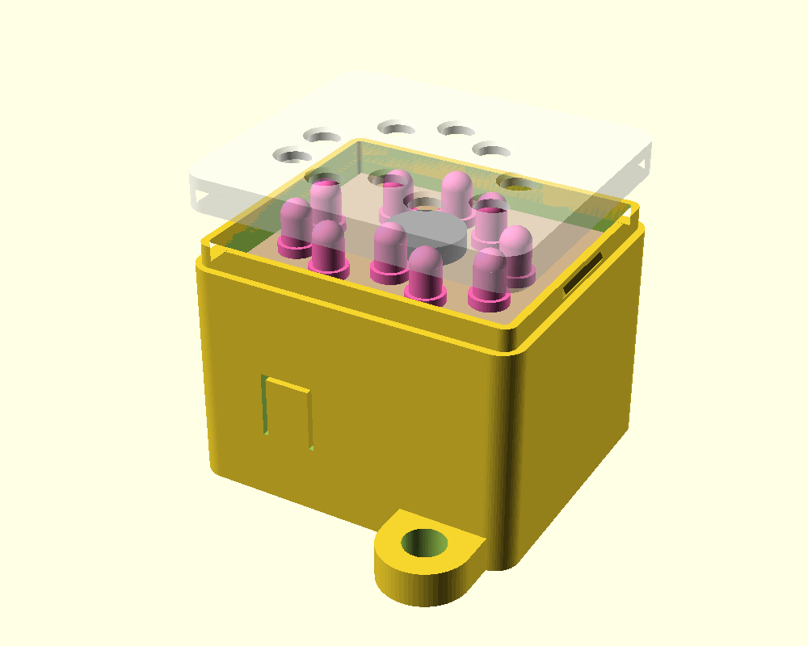

# GSM touch keychain, v2: project recap

Two keychains, one for each of you. Press the button on yours: hers vibrates and its heart
of 10 LEDs lights up, **about 3–5 seconds later, anywhere with 2G coverage**. Tap a rhythm
and hers plays the same rhythm back. She answers the same way.

v2 is the **module version**: no custom PCB, no SMD assembly. A Seeed XIAO ESP32-C3, a
SIM800L GSM module, a LiPo and a few through-hole parts are wired together by hand. It
replaces v1 (ATtiny85 on a custom PCB in `/hardware`, `/firmware`, `/enclosure`). v2 reuses
v1's heart perfboard, line protocol and relay server.



## What's in this folder

| Path | |
|---|---|
| `PARTS.md` | Parts list with quantities, shops and rough prices (≈ 1 600–2 250 Kč per pair) |
| `schematic/keychain-v2-schematic.pdf` (`.png`) | Schematic. KiCad 10 project `keychain-v2.kicad_pro`, generated by `gen_schematic.py`. The electrical rules check is clean |
| `case/out/case_v2_tray.stl`, `case_v2_lid.stl` | One case: tray + lid (lid already flipped for printing) |
| `case/out/case_v2_plate.stl` | Both cases on one plate |
| `case/out/keychain_v2_x2_ender3v2_PLA_0.12mm.gcode` | Ready to print on an Ender-3 V2 / Pro: PLA, 0.12 mm, **~3 h, 17 g** |
| `case/keychain_case_v2.scad`, `case/build.sh` | Parametric model + build script (STL, previews, G-code) |
| `case/out/heart_perfboard.png`, `.txt` | How to build the heart board (same as v1) |
| `backend/` | Relay server (Python, standard library), Docker/systemd, 19 tests |

## How it works

```
 [button] → XIAO ESP32-C3 ──UART──► SIM800L ──2G/GPRS──► 1NCE ──► internet ──► relay server
                                                                                   │  (your VPS)
 [motor + heart] ◄── XIAO ◄──UART── SIM800L ◄──2G── 1NCE ◄── internet ◄────────────┘
```

1. **Sending:**
   - Each keychain keeps **one TCP connection** open to the relay server.
   - When you press or tap, the keychain waits 1.5 s for the pattern to end, then sends it.
2. **Delivering:**
   - The server **pushes** the pattern to the partner straight away.
   - The partner's SIM800L listens to the network while asleep. It pulls its **RING pin**
     low, which wakes the XIAO from deep sleep. The XIAO reads the message, acknowledges it,
     vibrates and lights the heart.
3. **When the partner is offline** (no signal, flat battery):
   - The server keeps the message for up to 7 days and delivers it when the keychain reconnects.
   - Nothing is lost.
4. **Check-in every 5 minutes:**
   - Each keychain sends a short check-in (with its battery voltage) to keep the connection
     alive and to notice when it has dropped.
   - The check-in doesn't add delay to normal taps.

## Hardware

| | |
|---|---|
| MCU | Seeed **XIAO ESP32-C3**: 21 × 17.8 mm, USB-C, LiPo charger 380 mA, ~44 µA deep sleep |
| Modem | **SIM800L red mini** (2G), spring antenna; 1NCE SIM |
| Battery | **802530 LiPo**, 3.7 V, ~500 mAh, with protection board |
| Output | 0820 coin motor + 10 × 3 mm LEDs in a heart (perfboard), one BC337 driver |
| Input | 3 × 6 mm tact switch behind the XIAO, pressed through a flexing tab in the case wall |
| Buffer | 470 µF polymer tantalum at the SIM800L (covers its 2 A transmit bursts) |

### XIAO pin map

| Pin | Use | |
|---|---|---|
| D1 (GPIO3) | Button → GND | wakes from deep sleep, internal pull-up |
| D2 (GPIO4, A2) | Battery voltage ÷ 2 (220 k / 220 k + 100 nF) | |
| D3 (GPIO5) | SIM800L RING | wakes from deep sleep when data arrives |
| D4 (GPIO6) | PWM → 1 k → BC337 → motor + heart | 100 k keeps it off while asleep |
| D5 (GPIO7) | → 1 k → SIM800L RST | only ever pulled low |
| D6 (TX) | → 4.7 k / 15 k divider → SIM800L RXD | must be held high in deep sleep |
| D7 (RX) | ← SIM800L TXD | |
| BAT+ / BAT− | Battery (pads under the board) | SIM800L, motor and LEDs also run from the battery |
| D0, D8, D9, D10, 3V3, 5V | not used | D0/D8/D9 are boot pins |

## Power

| | |
|---|---|
| Charging | USB-C on the XIAO, 380 mA: **~1 h to 80 %, ~1.5–2 h full**. The keychain keeps working while charging |
| Average draw | ~2–2.5 mA: SIM800L idle ~1 mA + 5-minute check-ins ~1–1.5 mA + XIAO 0.04 mA |
| **Battery life** | **~7 days** with the 5-minute check-in; ~11–12 days with 15 minutes. These are estimates; the battery log will show the real number |

## Case

- **Outer size ~34 × 30 × 26 mm**, plus 1.5 mm LED domes and the keyring loop. It prints without supports.
- **Stack, bottom to top:**
  1. battery;
  2. XIAO (USB-C in the end wall), with the switch behind it and the small parts beside it;
  3. SIM800L;
  4. heart perfboard;
  5. lid with 10 LED holes.
- **The XIAO holds the switch in place.** The switch sits between the XIAO's back edge and the
  flexing tab in the end wall, so the XIAO takes the press.
- **The sizes are datasheet values.** Before printing the final case, measure your battery,
  XIAO (with USB-C), switch and LEDs. Then fix the numbers at the top of
  `keychain_case_v2.scad` and run `case/build.sh`. A first test print is a good idea anyway.

## Firmware: still to do

The v1 ATtiny85 firmware (`/firmware/keychain`) and its protocol work. v2 needs a port to the
ESP32-C3 (Arduino core):

- [ ] `Serial1` on D6/D7 for the modem. The same AT sequence as v1 (CSCLK=2, CIPRXGET=1, 1NCE APN), plus `AT+CFGRI=1` so data pulses RING.
- [ ] Deep sleep with wake on D1 (button) or D3 (RING), both low; timer wake for the check-in.
- [ ] Keep `seq`, the connection state and the check-in timer in RTC memory, because waking from deep sleep restarts the program.
- [ ] Hold D6 (TX) high during deep sleep (`gpio_hold_en`), or the modem never sleeps.
- [ ] LEDC PWM on D4. Battery reading on A2 (×2). Report "low battery" at ~3.5 V, sleep at 3.4 V.
- [ ] Reuse `protocol.h` and its host tests as they are.

## Before you buy and build: checks

- **1NCE:** check that they sell to private customers, and that their SIM works on 2G in Czechia.
- **2G in Czechia:** the SIM800L is 2G only. 2G is still running in CZ, but European networks are switching it off over the coming years. LTE-M (e.g. SIM7080G) would be the future-proof replacement.
- **Measure** the battery (802530 including its protection board), XIAO height, switch and LED height, then reprint.
- **Charge current:** check the XIAO's charging with a USB meter the first time (~380 mA expected).

## Previous version (v1)

`/hardware` (KiCad custom PCB, ATtiny85, TP4054), `/firmware`, `/enclosure` and `/server`
stay in the repo, in case you ever want the smaller custom-PCB build.
