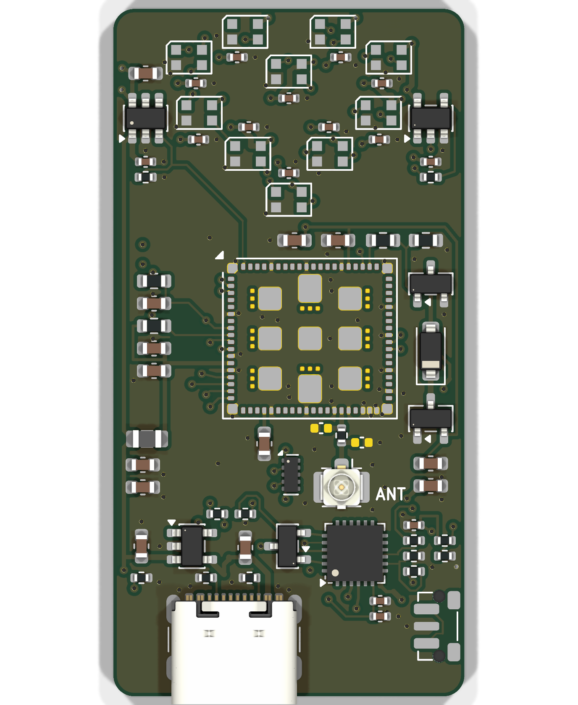
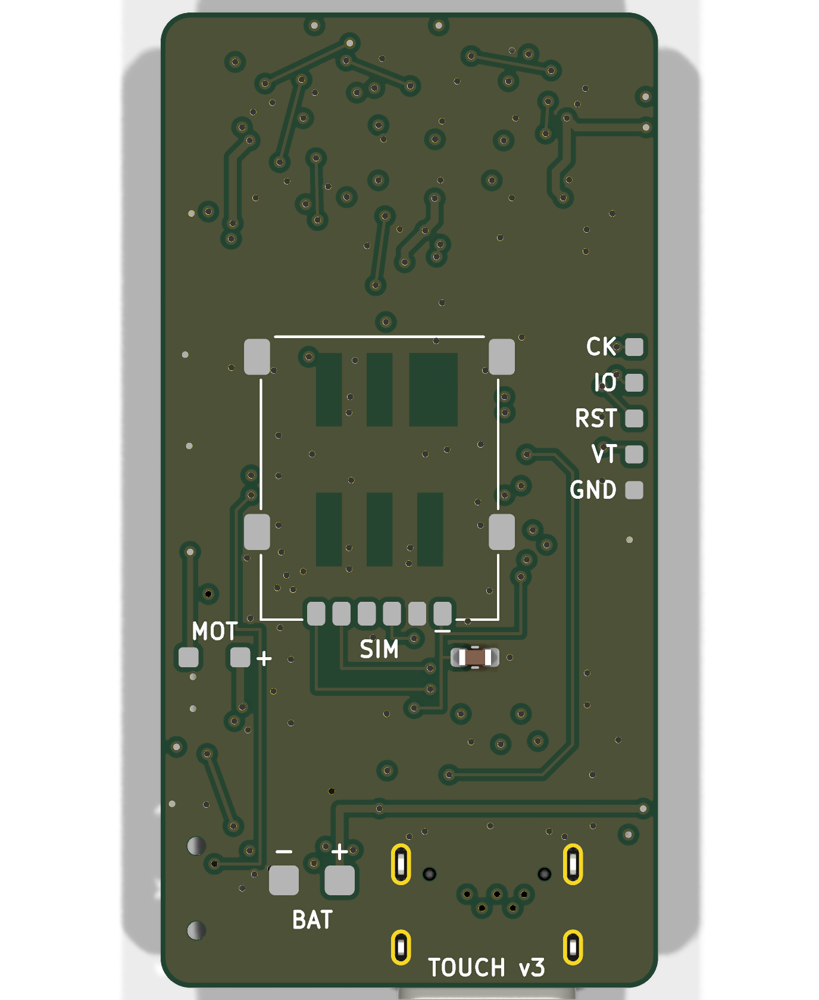

# GSM touch keychain, v3: one custom board with the nRF9151 (LTE-M)

v3 puts everything on **one 25 × 49 mm board** built around the **Nordic nRF9151**, including a
**heart of 10 RGB LEDs** and **programming over USB-C**. That
single chip holds the processor and the LTE-M/NB-IoT modem. There's no XIAO and no SIM800L,
and it's not affected by the 2G shutdown. You assemble it yourself.

| | v2 (modules) | **v3 (this)** |
|---|---|---|
| Network | 2G (SIM800L), ends for 1NCE ~end of 2027 | **LTE-M / NB-IoT** (4G), no 2G shutdown problem |
| Electronics | XIAO + SIM800L stacked, ~31 × 27 × 10 mm | **one 25 × 49 × ~4.5 mm board** with the RGB heart on it (USB-C is the tallest part) |
| Modem idle | ~1 mA (2G) | **µA level** with LTE-M power saving (PSM 2.7 µA, eDRX ~18 µA per Nordic) |
| Assembly | wires + through-hole | SMD: solder paste + stencil + hot plate (details below) |

 

## Files (`hardware/`)

| File | |
|---|---|
| `fab/schematic.pdf` | Schematic (A3). KiCad 10 project `keychain-v3.kicad_pro` |
| `keychain-v3.kicad_pcb` | The board: **4 layers, 1.0 mm**. ERC, DRC and schematic↔PCB parity are clean |
| `fab/keychain-v3-gerbers.zip` | **Upload this to JLCPCB** (all 4 copper layers, paste layers for the stencil, drills) |
| `fab/assembly-top.pdf`, `assembly-bottom.pdf` | Where every part goes, for hand placement |
| `fab/keychain-v3-pos-top.csv` | Part positions (only needed for machine assembly) |
| `BOM.md`, `fab/keychain-v3-bom.csv` | Parts list with suggested part numbers |
| `fab/keychain-v3.step`, `render-*.png` | 3D model for the case, pictures |
| `scripts/make_all.sh` | Regenerates everything: schematic → PCB → routing → checks → fab files |

## What's on the board

- **nRF9151** (U1):
  - Battery straight to VDD through a ferrite bead; no regulator needed (3.0–5.5 V).
  - The support parts follow Nordic's reference and the open-source Makerdiary nRF9151
    Connect Kit (CC BY-SA 4.0): 10 µF + 1 µF on VDD, 10 k ENABLE pull-up, 4.7 µF on DEC0,
    100 nF + 4.7 µF on VDD_GPIO, 1 k + 100 nF on reset.
- **3.0 V for the I/O pins** (U3, XC6206, 1 µA). It follows the battery up and down, which is the power-up order the nRF9151 requires.
- **Charger** (U2, TP4054) on USB-C:
  - **213 mA** (R3 = 4.7 k), which suits a 200–500 mAh cell. Use 3.3 k for 300 mA if the cell is at least 300 mAh.
  - "USB plugged in" goes to P0.31 (VBUS/2); with the battery voltage the firmware knows when it's charging.
- **Battery voltage** is measured by the modem itself (`AT%XVBAT`), so there are no divider resistors.
- **Nano-SIM** (J3, hinged holder on the bottom), with the ESD protection the SIM interface requires (U4).
  - U4 sits directly above the SIM contacts, as ESD protection should; its 100 nF (C13) is on the bottom next to the holder.
  - The nRF9151 runs SIMs at 1.8 V; 1NCE SIMs support that.
- **Antenna:**
  - A 50 Ω trace runs straight from the antenna pin to a **U.FL** socket.
  - It goes through a 0 Ω resistor and two unfitted pads (C14/C15) for later tuning.
  - Ground stitching vias around the socket; the 2nd layer is solid ground.
- **Motor:** AO3400A + flyback diode, the same as v1/v2, wired to the MOT+/− pads.
- **RGB heart (on the board):**
  - 10 × WS2812B-2020 addressable RGB LEDs on a heart curve at the end of the board, each with its own 100 nF.
  - A load switch (U6, TPS22917) cuts their power when they're dark: these LEDs draw ~1 mA each even when off, which would cost more than the whole keychain in standby.
  - A buffer (U7, SN74LV1T34) lifts the 3.0 V data to the LED supply. The LEDs are fed by a copper plane on layer 3 under the heart.
  - Any colour per LED and fades; full colour above ~3.6 V battery.
- **USB-C with data (CP2102N, U5):**
  - Firmware updates and the log go over USB-C. The SWD pads are needed only once, to install the bootloader.
  - The PC can reset the board through DTR/RTS (Q2, as on ESP32 boards). Idle, an open port and an unplugged cable never reset it.
  - The chip runs only from USB, so it costs no battery.
- **Side button** (SW1) on the right edge, pressed through the case's flexing tab.
- **Pads on the bottom:**
  - BAT+/−, MOT+/−;
  - **SWD** (CK, IO, RST, VT, GND), for the one-time bootloader flash.

Pins used: P0.05 motor PWM, P0.06 LED data, P0.19 LED power, P0.30 button, P0.31 USB plugged in, P0.24 UART TX, P0.25 UART RX (to the USB-serial chip)
(set these in the Zephyr devicetree; the nRF9151 can put the UART on any pin).

## Ordering

**PCB (JLCPCB):** upload `fab/keychain-v3-gerbers.zip` and choose:
- **4 layers, 1.0 mm**, impedance stack-up **JLC04101H-7628**. The antenna trace is sized for it (0.35 mm over layer 2). Check it in JLC's impedance calculator.
- **Surface finish: ENIG.** It isn't optional here: a flat finish matters for the nRF9151's pads underneath, and HASL is too uneven.
- Via covering: tented. Silkscreen: any colour.
- **Stencil:** order one with the PCB, **top side only, 0.10 mm thick**, framework-less is fine.

**Parts:** see `BOM.md`; LCSC, TME, Mouser or DigiKey all work. Order for **3 boards**, plus extra small parts.
- The **nRF9151-LACA** is the expensive part. It's sold as cut tape by DigiKey, Mouser and TME. Check the price; plan roughly €20–30 each.
- It's moisture sensitive (MSL 3): keep it in its sealed bag until you solder.

**Rough cost for a pair (+1 spare board):**

| Item | Approx. |
|---|---|
| PCB 4-layer ENIG × 5 + stencil + shipping to CZ | ~€35–60 |
| 3 × nRF9151 | ~€60–90 |
| Other parts for 3 boards (USB-C, SIM holder, U.FL, CP2102N, 30 RGB LEDs, ICs, passives) | ~€30–45 |
| 2 × LTE FPC antenna with U.FL | ~€5–20 |
| 2 × LiPo, 2 × motor, heart parts | ~€10–15 |
| 2 × 1NCE SIM | ~€24 |
| **Total** | **≈ €165–250 (≈ 4 100–6 200 Kč)** |

This is more than v2. You pay for the nRF9151 and a 4-layer ENIG board, and get LTE-M, much
lower standby current and a smaller keychain.

## Hand assembly

You need:
- **Hot plate**, about €25–40. Hot air works too, but a hot plate is easier for the nRF9151.
- **Solder paste:** Sn63/Pb37, the easiest to work with; or low-temperature paste.
- **Flux, fine tweezers,** a loupe or microscope, a multimeter, and isopropyl alcohol.
- **Current-limited bench supply** (optional, but very useful for the first power-up).

1. **Paste:**
   - Tape the board down with spare boards or scrap of the same thickness around it.
   - Line up the stencil and spread the paste in one stroke.
   - Check that every pad of the nRF9151, including the big centre ones, got paste.
2. **Place parts:**
   - Follow `assembly-top.pdf`. Start with the **nRF9151**, matching its pin-1 corner to the triangle on the silkscreen.
   - Then U2/U3/U4/Q1. Watch U4: it's tiny, and pin 1 has a dot.
   - Then the passives, USB-C, U.FL and SW1.
   - **Leave C14/C15 empty.**
3. **Reflow on the hot plate:**
   - Heat to ~150 °C for about a minute, then to the paste's peak: ~215–225 °C for Sn63, ~245 °C for lead-free.
   - Hold until all the paste has turned shiny, plus ~20 s.
   - Then slide the board off onto a metal surface.
   - Don't nudge the nRF9151 while hot: it self-centres on its pads.
4. **Inspect:**
   - Check for bridges on the USB-C, U2 and U4 with a loupe; fix them with flux + iron + solder wick.
   - You can't see under the nRF9151, so test it electrically (step 6).
5. **Bottom side, with an iron:**
   - The **SIM holder**: its contacts are on the outer edge, and the 4 shield tabs are at its sides.
   - C13 (100 nF, 0603) next to the holder.
   - Then the wires to the battery and the motor.
6. **First power-up, before connecting a battery:**
   - Put **3.8 V** on BAT+/− from a supply limited to ~100 mA. Idle current should be a few mA or less, with nothing getting warm.
   - **VT** should read **3.0 V**.
   - Then plug in USB-C: about 213 mA should flow into a battery.
7. **First flash, once, over SWD:**
   - Connect a debug probe to **CK/IO/RST/VT/GND**: a J-Link, the debug-out of an nRF9151 DK, or a borrowed / €5 Pico probe with pyOCD.
   - Flash the **MCUboot** bootloader together with the first app.
   - MCUboot is set to wait ~0.5 s after every reset for an update over the USB serial port.
8. **From then on, over USB-C only:**
   - The board shows up as a USB serial port (CP2102N). Log: any serial terminal at 115200.
   - Update: `mcumgr --conntype serial --connstring "dev=<port>,baud=115200" image upload app.bin`, then `reset`.
   - The PC resets the board by setting DTR high and RTS low. A small script in the firmware folder will do this.
   - LTE-M test: the `at_client` sample over USB, `AT+CFUN=1`, then `AT+CEREG?`. Registration status 1 or 5 means LTE-M works with the 1NCE SIM.

## Design review (2026-11-25)

DRC only proves the geometry is legal, so the board was also checked for design mistakes.
Found and fixed:

| Problem | Fix |
|---|---|
| Wide-track rules didn't apply to the nRF9151 supply and the motor line: the schematic names those nets `/VDD_NRF` and `/MOT_N`. VDD was routed 0.11 mm wide over 34 mm and 3 layers; the motor line went down to 0.09 mm | Rules match the real net names. VDD: 0.3 mm on the top layer only, fixed short track from pin 14 to C5/C6. Motor: 0.3 mm |
| Side button rotated the wrong way: actuator into the board, pads at the edge | Rotated 180°; the actuator now sticks 0.24 mm out of the right edge |
| Charger input and output caps (C1/C2) were 8.5 mm from the TP4054 | Charger block moved next to the battery pads; caps 2.7 and 4 mm from the pins |
| Signal and power vias under the nRF9151 | Keep-out while routing: only ground vias under the SiP, and layer 2 is solid ground there |
| SIM ESD (U4) and its 100 nF sat by the SiP, far from the SIM contacts | U4 moved directly above the contacts, with fixed short runs to each contact. The 100 nF is on the bottom next to the VCC contact |
| Several caps had their signal pad on the far side (C5, C6, C9, C10, C12) | Rotated; DEC0 cap 1.6 mm and VDD_GPIO 100 nF 1.9 mm from their pins |
| The two unfitted antenna pads would have got solder paste | Own footprint without stencil openings |
| Alternative charger part: the MCP73831 drives its status pin to 5 V, which would damage the nRF9151's 3.0 V pin | BOM now names the MCP73832 (open-drain status) |
| The left side of the SiP was too crowded to route cleanly | Board 2 mm wider. UART moved to P0.24/P0.25 and the debug pads put in pin order |

Checked and OK:
- every part's pinout against its footprint;
- the nRF9151 reference circuit;
- the USB-C front at the board edge;
- the RF path (no other copper near it, ground under and around it);
- the SIM holder's keep-out areas;
- 1.0 mm 4-layer stack-up, 0.3/0.6 mm vias, minimum track 0.11 mm (JLC 4-layer allows 0.09).

### Added after the review: USB programming and the RGB heart (2026-11-26)

- **USB corner:** laid out by pin order.
  - The CP2102N sits between the antenna socket and the button.
  - The reset transistor sits at its DTR/RTS pins; its caps and dividers sit at their pins.
- **Fixed routing:** the USB data pair is a fixed pair on layer 3, joined under the connector body so both plug orientations work.
- **Heart:** the LED chain runs on the bottom layer under the heart, and the LED supply is a plane on layer 3.
- **Hand-routed nets:** the SIM lines, reset, enable, the battery feed to the regulator and the LED data were drawn as fixed tracks, so the result doesn't depend on autorouter luck.
- **Charge status (CHRG):** dropped; the firmware uses *USB plugged in* plus the battery voltage instead.
- **Result:** ERC, DRC and schematic↔PCB parity are clean. The board is 25 × 49 mm and has 73 parts.

## Status and open points

- **Firmware: not written yet.**
  - v3 needs a Zephyr / nRF Connect SDK version of the keychain firmware.
  - The protocol (`firmware/keychain/protocol.h`) and the relay server (`v2/backend`) stay the same.
  - LTE-M power saving (eDRX) decides how fast incoming taps arrive (a few seconds to ~20 s) and how long the battery lasts. That gets tuned on the real board.
- **Modem firmware:** check the version with `AT%SHORTSWVER`. Updating it needs `nrfutil` and a J-Link-compatible probe.
- **Antenna:**
  - LTE-M uses 800/900 MHz in Czechia, and antennas for those bands want length. A small flexible antenna inside a keychain will work, with reduced range.
  - Use the biggest one that fits; tuning with C14/C15 needs a network analyser.
- **1NCE LTE-M in Czechia** probably runs via T-Mobile CZ, but that isn't confirmed. Test one SIM first, e.g. on an M5Stamp CatM or an nRF9151 dev kit.
- **First build:**
  - This is a new design and hasn't been made yet. Order the spare SiP.
  - Hand-soldering an LGA chip is the hardest step, so expect one board to need rework.
- **Case:** not yet adapted to v3. Once you've picked the battery, the case can be redrawn around the 25 × 49 mm board: thinner than v2, with the heart under a translucent lid or light holes.
