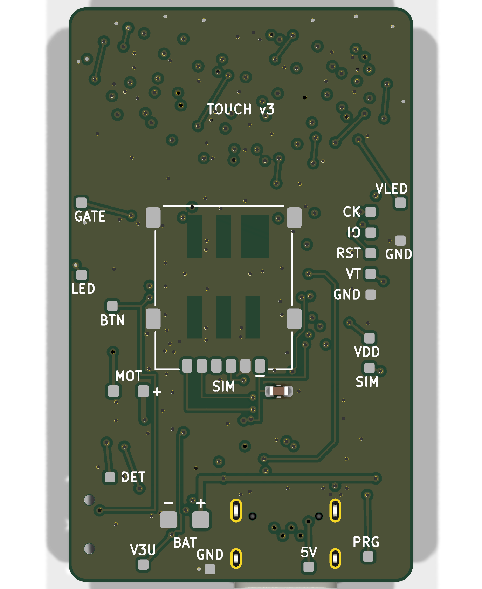

# Testing a freshly soldered v3 board

Work through this top to bottom after soldering, **before** the board goes into the case. Each step only needs what the step before it proved. Fill in the "measured" column; printing this page works well.

You need:
- a multimeter
- ideally a USB power meter (USB-C "doctor") between the charger and the board
- the LiPo
- the SWD probe from [PROGRAMMING.md](PROGRAMMING.md)

## Where the pads are

All test pads are on the **bottom** side and labelled on the silkscreen. In the picture you're looking at the bottom, so left and right are swapped compared with the top side.

| Label | Net | Where (bottom view) | What it tells you |
|---|---|---|---|
| **BAT + / −** | VBAT / GND | big pads above the USB-C | battery |
| **5V** | VBUS | bottom edge, between the USB-C mounting legs | 5 V from USB |
| **V3U** | V3U | bottom left corner | USB-serial chip's own 3.3 V |
| **PRG** | PROG | bottom right corner, beside the USB-C | charging current |
| **GND** | GND | below the BAT pads, at the right edge beside the SWD column, and in the SWD column | black probe goes here |
| **CK IO RST VT GND** | SWD | right edge, column beside the SIM holder | programming; **VT** = the 3.0 V rail |
| **VLED** | VLED | right edge, just above the SWD column | LED supply, switched |
| **VDD** | VDD_NRF | right edge, below the SWD column | nRF9151 main supply (battery through the ferrite) |
| **SIM** | SIM_1V8 | right edge, below VDD | SIM card supply from the modem |
| **GATE** | GATE | left edge, top (level with the SIM holder's top) | motor MOSFET gate |
| **LED** | LED_DIN | left edge, below GATE | data into the first LED (after the level shifter) |
| **BTN** | BTN | left edge, below LED | side button |
| **DET** | USB_DET | left edge, above the BAT pads | "USB plugged in" signal for the nRF |

## Step 1: Look (magnifier or phone camera)

| Check | ok? |
|---|---|
| nRF9151 (U1) sits flat and square, no solder balls along its edges | ☐ |
| No bridges on the USB-C pins, the CP2102N (U5), the ESD chip (U4), or the SOT-23 parts | ☐ |
| LEDs (D3–D20, Würth 1312020030000): the pin-1 corner of each LED matches the dot on the assembly drawing (`assembly-top.pdf`). The LEDs are turned 0/90/180/270° around the heart, so check each one | ☐ |
| U.FL connector straight, centre pin not bridged to the shield | ☐ |
| Charger U2, LDO U3, load switch U6 and level shifter U7 the right way round (pin-1 dot) | ☐ |
| SIM holder: all 6 contacts and 4 shield tabs soldered | ☐ |

## Step 2: Resistance to GND, **no power** (no battery, no USB)

Black probe on **GND**, multimeter on Ω. The capacitors charge up, so the reading creeps upwards; what matters is **not 0 Ω**.

| Pad | Expect | If wrong | measured |
|---|---|---|---|
| BAT+ | > 1 kΩ, rising | ~0 Ω: short on VBAT (charger, LDO, C3/C4, ferrite, D1) | |
| 5V | ≈ 50 kΩ (two dividers) | ~0 Ω: USB-C pins bridged | |
| VDD | > 1 kΩ, rising | ~0 Ω: short at the nRF9151 supply pins or C5/C6 | |
| VT (3.0 V) | > 1 kΩ, rising | ~0 Ω: short on +3V0 | |
| V3U | > 1 kΩ | ~0 Ω: short at the CP2102N | |
| VLED | > 1 kΩ | ~0 Ω: short in the heart (LED or 100 nF cap) | |
| SIM | > 1 kΩ | ~0 Ω: short at the SIM holder or ESD chip | |
| PRG | **4.7 kΩ** (R3) | other: R3 wrong or bridged | |
| GATE | **≈ 100 kΩ** (R8) | ~0 Ω: Q1 or R8 bridged | |
| DET | **≈ 60 kΩ** | 0 or open: R15/R16 | |
| BAT+ ↔ BAT− | not shorted | | |

## Step 3: USB only, no battery

Plug in USB-C, ideally through the USB power meter. **Current should settle below ~30 mA.** If it's higher, unplug and look for something getting warm.

| Pad | Expect | If wrong | measured |
|---|---|---|---|
| 5V | 4.8–5.2 V | 0 V: USB-C VBUS pins or CC resistors R1/R2 (a USB-C charger gives 0 V without them) | |
| V3U | 3.3 V | 0 V: CP2102N not powered or not soldered | |
| DET | ≈ 2.5 V (half of VBUS) | 0 V: R15/R16 | |
| BAT+ | ≈ 4.2 V (charger output with no battery; may wobble) | 0 V: charger U2 | |
| VDD | same as BAT+ | 0 V: ferrite FB1 open | |
| VT | 3.0 V | 0 V: LDO U3 | |
| SIM | 0 V (modem off) | | |
| VLED | 0 V (LEDs off) | ≈ BAT: load switch on, check R17 / U6 | |
| GATE | 0 V | > 0 V: motor would run, check R8 | |

The computer should now see a **CP210x USB-serial port**: `ls /dev/tty.usbserial*` on macOS, Device Manager on Windows.

## Step 4: Battery only

Unplug USB. Solder the LiPo, **red to BAT+**. Double-check polarity first: reversed polarity kills the charger and the LDO.

| Pad | Expect | measured |
|---|---|---|
| BAT+ / VDD | battery voltage (3.0–4.2 V) | |
| VT | 3.0 V | |
| 5V, V3U, DET | 0 V | |
| Current from the battery (meter in series in the red wire, mA range) | small: < 1 mA with the chip still empty | |

## Step 5: Battery + USB, charging

| Pad | Expect | measured |
|---|---|---|
| PRG | ≈ 1.0 V while charging at full current. Charge current = V(PRG) × 213 mA (1.0 V → 213 mA). Drops towards 0 V as the battery fills. | |
| BAT+ | rises slowly towards 4.2 V | |

## Step 6: First flash (SWD)

See [PROGRAMMING.md](PROGRAMMING.md). The battery or USB must be connected, and **VT must read 3.0 V** before you connect the probe.

| Check | ok? |
|---|---|
| `pyocd list` sees the Pico; `pyocd` connects to the nRF9151 | ☐ |
| chip erase + flash of MCUboot + app OK | ☐ |
| log text appears on the USB-C serial port (115200 baud) | ☐ |
| a second upload over USB-C with `mcumgr` works (no probe) | ☐ |

## Step 7: With firmware: each function

These need the test firmware (one command per function over the USB serial console).

| Function | Measure | Expect | ok? |
|---|---|---|---|
| Button | BTN | 3.0 V released, 0 V pressed | ☐ |
| Motor | GATE | 3.0 V while the motor runs, 0 V otherwise; motor buzzes | ☐ |
| LED power | VLED | ≈ battery voltage while the heart is on, 0 V when off | ☐ |
| LED data | LED | a few hundred mV to ~1 V average while data is being sent (pulses), 0 V idle; all 18 LEDs show the test colours | ☐ |
| Serial | USB-C port | log text in a serial terminal (115200 baud) | ☐ |
| Modem + SIM | SIM | 1.8 V (or 3.0 V, depending on the SIM) once the modem is switched on with a SIM inserted | ☐ |
| Network | log | modem registers on LTE-M (`+CEREG: 1` or `5`) with the antenna connected | ☐ |
| Sleep current | battery meter | after the board goes to sleep: well under 1 mA average (expect tens of µA between paging wake-ups) | ☐ |

**Never transmit without the antenna plugged into the U.FL.** Testing the modem without an antenna can damage its RF output.
